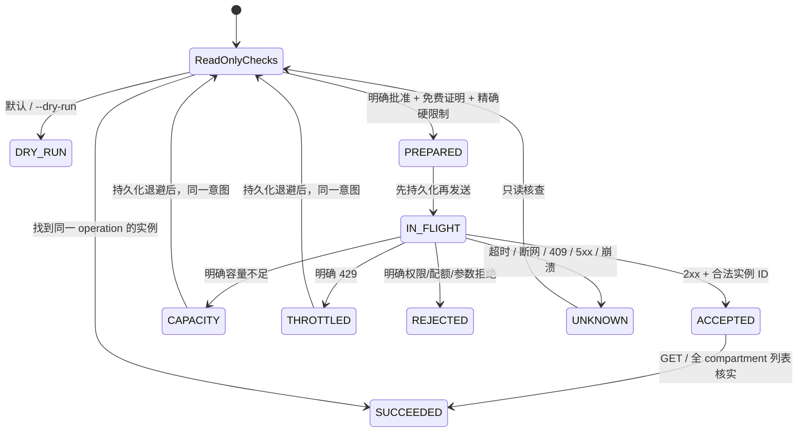

# 幂等机制、恢复和保证边界

## 唯一创建意图

一个租户只允许本工具的一个 Tokyo A1 2/12 意图。状态路径由 OS 用户身份决定，Windows 使用系统返回的 Local AppData，Linux 使用 passwd 中的 home；不使用 cwd、仓库目录、config 路径或可覆盖的 HOME/LOCALAPPDATA 环境变量。目录名为租户 SHA256，不把租户标识放入文件名。

Windows 使用 msvcrt 内核文件锁，Linux 使用 flock；锁覆盖核查、状态写入、OCI 子进程和返回结果写入。文件锁不靠 PID 文件或删除 lock 文件判断，不存在自动清理旧锁的竞争窗口。进程退出时内核释放锁。真实 journal/headers 存在私有状态目录；不放在百度同步的仓库中。

完整请求体、摘要、operation tag、同一 opc-retry-token 和首次时间先写入 PREPARED，再写入 IN_FLIGHT，均执行 flush / fsync / 原子 replace。POSIX 还 fsync 父目录；Windows 依赖本地 NTFS 和正常的持久化存储。磁盘不能可靠持久化时不得部署，任何写入异常均停止。

token 按租户和固定意图确定性生成，可保护短时间内的全新 checkout；持久化 journal 才提供跨重启和过期后的“不得自动创建新意图”约束。token 不作为授权凭据使用，仍按私有数据处理，不输出到 CLI 参数、日志或报告。headers/body 使用私有临时文件，CLI 只接收文件路径。

## 状态转换

默认单次命令最多发送一次创建请求。容量不足至少等待 600 秒；429 尊重 Retry-After 且至少 600 秒。等待截止时间保存在 journal，重启不能绕过。每次再次发送仍需全部 API 核查和有效人工复核，不能复用旧的库存快照；超过 60 秒的核查不授权发送。

Unknown 不自动重发：重启先查所有实例，包括启动中实例；已知 ID 再 GET，找不到或失败便停止。查询后仍未找到且 token 未超过 23h，只有在用户明确批准恢复并使用 `--create --resume-unknown` 时，才可按相同 token/完整 body 再发；最终依靠服务端幂等合并可能已接受的请求。不能修改 image/subnet/name/public key 后沿用已有意图。

超过 23h 不重发，不自动生成新 token。Conflict、DuplicateRequest、InvalidatedRetryToken 和未知 5xx 都按 UNKNOWN 处理。REJECTED、SUCCEEDED、BLOCKED 不允许自动变成新意图；即使原实例后来终止，也不自动补建。没有 reset/force-create 命令。

## 必须保留的条件

本机状态目录必须持久、私有、不被同步或人为删除；所有本机运行使用同一 OS 身份。跨用户/多主机/控制台同时创建没有共同锁，必须停止这些创建源并证明独占，否则审批应保持 false。API 列表有最终一致性，空列表本身不解决未知请求；同 token 重放只在安全时间内使用。

如果状态丢失、token 过期但请求仍不明，人工核对所有 compartment、请求记录/审计事件和实例，不运行旧版脚本、不删新 journal、不通过换名称或新目录继续尝试。该工具选择停止，不能用纯本地代码在不改云端控制的条件下伪造账户级原子互斥。
